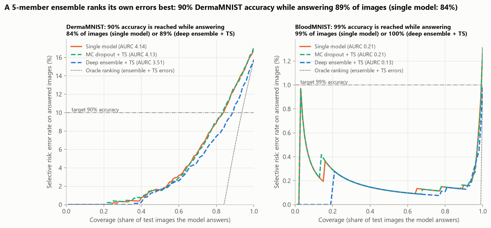
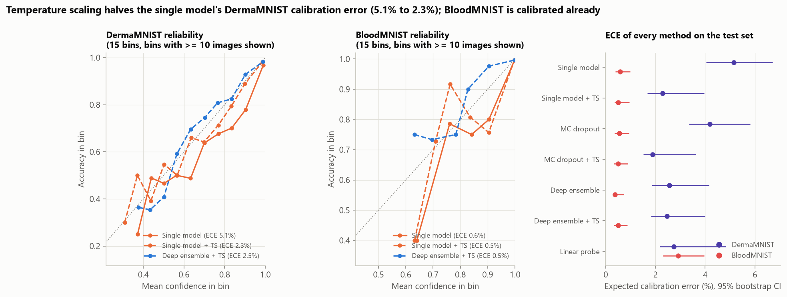
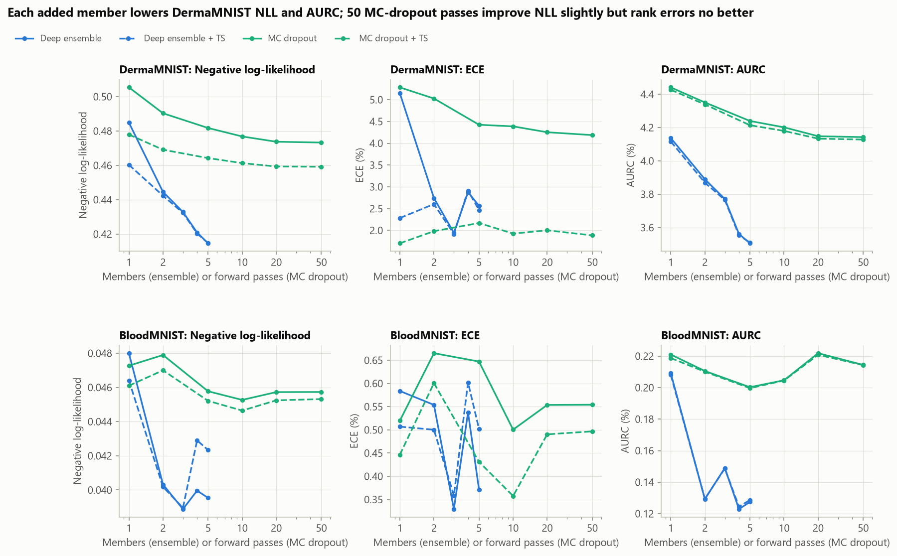
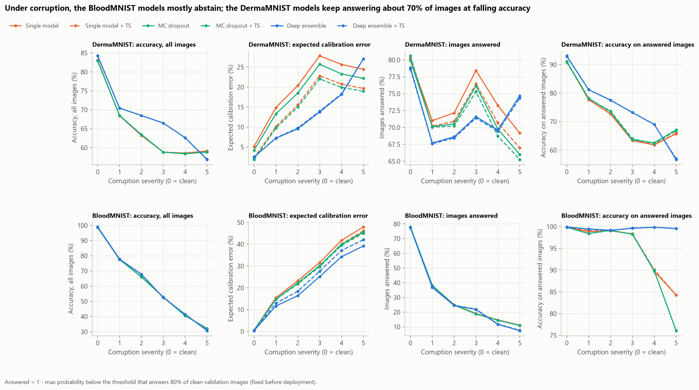
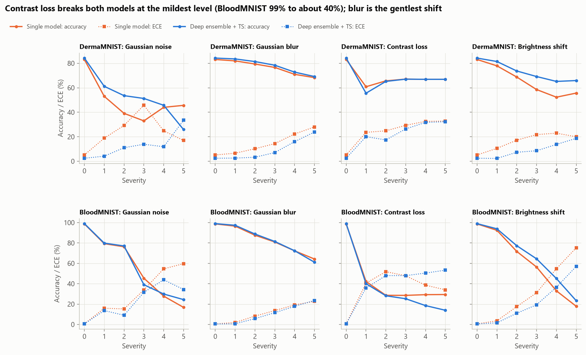
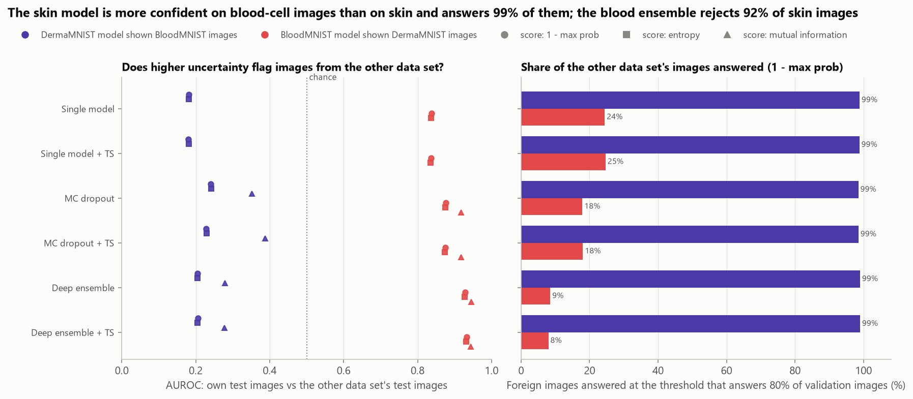
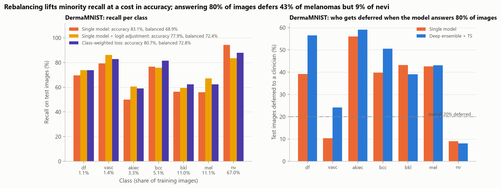
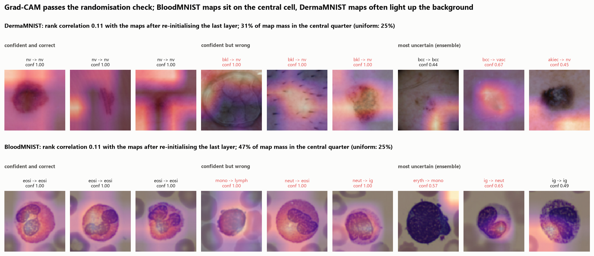
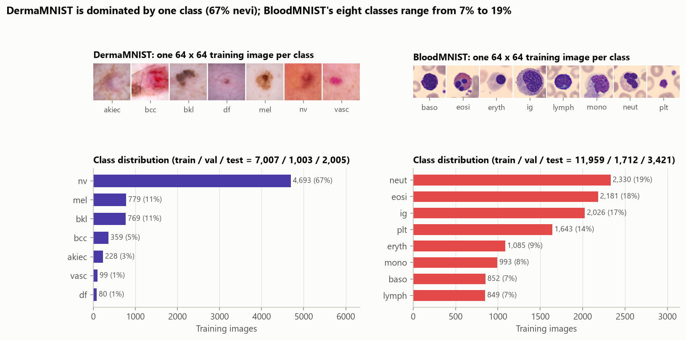

# Medical Image Classification That Knows When Not to Predict

[](https://github.com/ChetanYarlagadda/medical-image-uncertainty/actions/workflows/ci.yml)

**Can an image classifier tell when its own answer should not be trusted, and does that still hold when the images
are degraded or come from the wrong modality?** This project fine-tunes ImageNet ResNet-18 models on two MedMNIST+
data sets at 64 x 64 pixels, DermaMNIST (dermatoscopic skin lesions, 7 classes, 67% one class) and BloodMNIST
(blood-cell microscopy, 8 classes), and compares six ways of attaching uncertainty to a prediction: one model's
softmax, Monte Carlo dropout and a 5-member deep ensemble, each with and without temperature scaling.

It mirrors the medical-imaging work of a clinical decision-support team: a triage model should answer the cases it
is sure about and defer the rest to a clinician. The models are therefore judged on calibration (does a 90%
confidence mean 90% accuracy?), on selective prediction (how accurate are the answered images when the least
certain ones are deferred?), under synthetic corruptions with a deferral threshold fixed on clean data, on images
from the other data set, per class, and with Grad-CAM maps that are checked by randomising the model.



## Key findings

| Test set | Method | Accuracy | AUC | NLL | ECE | AURC | Coverage at target accuracy |
|---|---|---:|---:|---:|---:|---:|---:|
| DermaMNIST (2,005 images) | Linear probe on frozen ImageNet features (baseline) | 0.751 | 0.915 | 0.663 | 2.7% | 8.37% | 65% at 90% |
| | Single model (softmax) | 0.831 | 0.965 | 0.485 | 5.1% | 4.14% | 84% at 90% |
| | Single model + temperature scaling | 0.831 | 0.965 | 0.460 | 2.3% | 4.12% | 83% at 90% |
| | MC dropout (50 passes) + TS | 0.829 | 0.965 | 0.459 | 1.9% | 4.13% | 83% at 90% |
| | **Deep ensemble (5) + TS** | **0.842** | **0.971** | **0.415** | 2.5% | **3.51%** | **89% at 90%** |
| BloodMNIST (3,421 images) | Linear probe on frozen ImageNet features (baseline) | 0.880 | 0.989 | 0.348 | 2.9% | 2.52% | 51% at 99% |
| | Single model (softmax) | 0.987 | 0.9991 | 0.048 | 0.6% | 0.21% | 99.4% at 99% |
| | **Deep ensemble (5) + TS** | **0.990** | **0.9993** | 0.042 | 0.5% | **0.13%** | 100% at 99% |

<sub>AUC is the mean one-vs-rest AUC (the MedMNIST metric); NLL is the mean negative log-likelihood; ECE is the
top-label expected calibration error (15 bins); AURC is the area under the risk-coverage curve (mean error rate of
the answered images over all coverages; lower is better). Every method, with 95% bootstrap CIs, is in
[`method_results.csv`](reports/results/method_results.csv).</sub>

1. **A deep ensemble is the only method that ranks its own errors better.** On DermaMNIST, five ensemble members
   lower AURC from 4.14% to 3.51% (difference -0.63 points, 95% CI [-0.89, -0.36], Holm-adjusted p = 0.0005) and
   reach 90% accuracy while answering 89% of images instead of 84%. The gain holds against a temperature-scaled
   single model (AURC -0.61 points, Holm p = 0.001), and NLL (0.415 vs 0.485) and AUC (0.971 vs 0.965) improve with
   it. On BloodMNIST everything is near the ceiling (98.7-99.0% accuracy) and no difference survives the Holm
   correction over 70 tests.
2. **Temperature scaling fixes calibration but not ranking, and MC dropout adds little.** One temperature fitted on
   the validation set (T = 1.30) halves the single model's DermaMNIST ECE (5.1% to 2.3%, Holm p = 0.001) and leaves
   its AURC unchanged; the calibrated single model is as well calibrated as the ensemble (2.3% vs 2.5%, n.s.).
   MC dropout in the classifier head, with 50 passes, is indistinguishable from the temperature-scaled single
   model on every metric.
3. **With a deferral threshold fixed on clean validation images, only the blood-cell ensemble stays safe under
   corruption.** Averaged over four corruptions at five severities, the BloodMNIST models answer 21% of the
   corrupted images (78% of clean ones); the ensemble is right on 99.5% of what it answers, the single model on
   94.8% (84.3% at the highest severity). The DermaMNIST models keep answering about 70% of corrupted images
   and are right on only 68-72% of them (91-93% on clean images). At the strongest contrast loss, every
   DermaMNIST member calls all 2,005 lesions a nevus and answers every one.
4. **The skin model is more confident on blood cells than on skin.** Shown BloodMNIST images, the DermaMNIST models
   give a mean confidence of 0.97-0.99, call 99% of them "vascular lesion" and answer 98-99% of them at the
   threshold that answers 80% of their own validation images; the uncertainty separates the foreign images
   *inversely* (AUROC 0.18-0.39). The BloodMNIST ensemble does flag skin images (AUROC 0.93, 92% rejected; single
   model 0.84, 76% rejected).
5. **Abstention is not spread evenly over classes, and rebalancing costs accuracy.** When the DermaMNIST single
   model answers 80% of images it defers 43% of melanomas but 9% of nevi, and still misclassifies 39% of the
   melanomas it answers. Post-hoc logit adjustment raises melanoma recall from 56% to 67% (74% on the ensemble) and
   balanced accuracy from 0.689 to 0.724, at a cost of 5 points of accuracy; a class-weighted loss lands in between
   (accuracy 0.807, balanced accuracy 0.728).
6. **The benchmark check passes and the Grad-CAM maps depend on the model.** Both data files match the published
   MD5 digests, split sizes and licences (20 of 20 checks). The fine-tuned models score above the published
   MedMNIST v2 ResNet-18 baselines (DermaMNIST accuracy 0.831 vs 0.735-0.754, BloodMNIST 0.987 vs 0.958-0.963),
   which trained on 28-pixel images without the pretraining used here. Re-initialising only the last layer drops the
   rank correlation of the Grad-CAM maps to 0.11 on both data sets, so the maps reflect the trained weights.

## Results

### Calibration



The DermaMNIST single model is overconfident: its fitted temperature is 1.30 (1.23 for MC dropout), and its
reliability curve sits below the diagonal above 60% confidence. Averaging five members already produces a calibrated
distribution (ensemble temperature 0.98), so temperature scaling changes the ensemble very little. On BloodMNIST
the single model is already calibrated (ECE 0.6%, T = 1.08); the ensemble is slightly underconfident (T = 0.77),
and scaling it with that temperature makes test NLL and ECE slightly worse (0.040 to 0.042 and 0.37% to 0.50%),
because the validation set contains only 11 ensemble errors to fit it on.

Paired bootstrap tests over test images (1,000 draws, Holm-corrected together over 70 comparisons;
[`significance.csv`](reports/results/significance.csv)):

| DermaMNIST comparison | Accuracy | AUC | NLL | ECE | AURC |
|---|---:|---:|---:|---:|---:|
| Single + TS vs single | 0 | +0.0001 | **-0.025** | **-0.029** | -0.0002 |
| MC dropout + TS vs single + TS | -0.002 | +0.0003 | -0.001 | -0.004 | +0.0001 |
| Deep ensemble vs single | +0.011 | **+0.0063** | **-0.070** | -0.026 | **-0.0063** |
| Deep ensemble + TS vs single + TS | +0.011 | **+0.0063** | **-0.046** | +0.002 | **-0.0061** |

<sub>Bold: Holm-adjusted p < 0.05. The ensemble's accuracy gain (95% CI [+0.001, +0.022]) and ECE gain over the
raw single model (CI [-0.043, -0.006]) have unadjusted p = 0.03 and 0.01, which do not survive the correction.</sub>

### Selective prediction

The risk-coverage curve (top figure) sorts the test images by 1 - max probability and plots the error rate of the
most certain fraction. All methods beat the frozen-feature baseline by a wide margin; among the fine-tuned ones only
the ensemble moves the curve. Its advantage comes in the 60-95% coverage range that matters for triage: at 80%
coverage the answered DermaMNIST images are 92.6% correct with the ensemble and 91.2% with the single model.
The oracle line, which defers every error first, shows how far ranking is from perfect: the ensemble's 3.51% AURC
compares with 1.32% for a perfect ranking of the same errors. Predictive entropy ranks errors about as well as
1 - max probability, and the mutual information between members or dropout passes ranks them worse (DermaMNIST
ensemble AURC 4.72% vs 3.51%; [`uncertainty_scores.csv`](reports/results/uncertainty_scores.csv)): disagreement
between members is not the best signal of an error here.



Every added ensemble member helps on DermaMNIST (NLL 0.485, 0.445, 0.433, 0.421, 0.415 for 1-5 members; AURC 4.14%
to 3.51%), with no sign of a plateau at five. MC dropout converges by about 20 passes, to an NLL of 0.473 and
an AURC of 4.14%, the deterministic single model's value; one dropout pass alone is worse (AURC 4.44%).

### Corrupted images



Each test set was corrupted with Gaussian noise, Gaussian blur, contrast loss and a brightness shift at five
severities (ImageNet-C settings, blur scaled to 64 pixels). The deferral threshold is fixed beforehand on the clean
validation set at the value that answers 80% of images, as it would be in deployment
([`corruption_results.csv`](reports/results/corruption_results.csv)).

| Mean over 20 corrupted test sets | DermaMNIST single | DermaMNIST ensemble + TS | BloodMNIST single | BloodMNIST ensemble + TS |
|---|---:|---:|---:|---:|
| Accuracy (clean) | 0.616 (0.831) | 0.650 (0.842) | 0.538 (0.987) | 0.541 (0.990) |
| ECE (clean) | 22.6% (5.1%) | 15.3% (2.5%) | 32.0% (0.6%) | 27.6% (0.5%) |
| Images answered (clean) | 72.8% (80.1%) | 70.2% (78.7%) | 21.6% (77.7%) | 20.7% (77.4%) |
| Accuracy of the answered images (clean) | 68.3% (91.1%) | 71.6% (93.1%) | 94.8% (99.8%) | 99.5% (99.9%) |

<sub>Accuracy of the answered images is averaged over the corrupted sets in which at least one image is answered.</sub>

The two data sets behave in opposite ways. Corrupted blood-cell images look unfamiliar to the BloodMNIST models,
their confidence falls and most images are deferred; what the ensemble still answers stays correct. Corrupted skin
images do not lower the DermaMNIST models' confidence enough, so they keep answering most of them at much lower
accuracy. Under contrast loss and strong blur the ensemble's mean entropy even falls below its clean value (0.06
and 0.23 at severity 5 against 0.42 clean) as the predictions collapse onto the nevus class.



Contrast loss is the most damaging shift: at the mildest level BloodMNIST accuracy falls from 99% to 40-42%, and
from severity 4 on, every DermaMNIST member calls at least 99.7% of the images nevi (all 2,005 at severity 5, so
accuracy equals the nevus share, 66.9%). Blur is
the gentlest. The ensemble's accuracy gain under corruption comes mostly from brightness and mild noise on
DermaMNIST (brightness severity 3: 69.2% vs 58.6%); at the strongest noise level it is worse than the single model
(25.9% vs 45.6%).

### Images from the other data set



Each model was shown the other data set's test images, which a deployment should reject
([`ood_detection.csv`](reports/results/ood_detection.csv)). The BloodMNIST models flag dermatoscopic images
reasonably well, and the ensemble most of all (AUROC 0.93 with 1 - max probability, 0.94 with mutual information;
8% answered against 24% for the single model). The DermaMNIST models fail completely: they are *more* confident on
blood-cell images than on skin lesions, put 99% of them in the "vascular lesion" class (plausibly because the red-purple
stain resembles a vascular lesion's colour) and answer 98-99% of them. No score or method rescues this; mutual information
from MC dropout gets closest to chance (AUROC 0.39). Confidence-based abstention therefore needs a separate input
check (modality or out-of-distribution detector) in front of it.

### Class imbalance and who gets deferred



| DermaMNIST ([`imbalance.csv`](reports/results/imbalance.csv)) | Accuracy | Balanced accuracy | Melanoma recall | Nevus recall | ECE |
|---|---:|---:|---:|---:|---:|
| Single model (plain cross-entropy) | 0.831 | 0.689 | 0.561 | 0.944 | 5.1% |
| Single model + post-hoc logit adjustment | 0.779 | 0.724 | 0.673 | 0.836 | 6.0% |
| Class-weighted loss (weights proportional to n^-0.5) | 0.807 | 0.728 | 0.623 | 0.879 | 5.3% |
| Class-weighted loss + TS | 0.807 | 0.728 | 0.623 | 0.879 | 1.5% |
| Deep ensemble + TS | 0.842 | 0.693 | 0.552 | 0.950 | 2.5% |
| Deep ensemble + TS + logit adjustment | 0.754 | 0.755 | 0.740 | 0.774 | 4.1% |

Logit adjustment (dividing each probability by the class prior) needs no retraining and gives the highest balanced
accuracy when applied to the ensemble, but every rebalancing step moves errors from rare classes to nevi rather
than removing them. Deferral concentrates on the rare classes: at 80% coverage the single model defers 56% of
actinic keratoses, 43% of melanomas and 43% of benign keratoses, but 9% of nevi
([`deferral_by_class.csv`](reports/results/deferral_by_class.csv)). On BloodMNIST, immature granulocytes are
deferred most (45% single, 51% ensemble).

### Grad-CAM



Grad-CAM is computed on ensemble member 0 at ResNet-18's layer3, which is a 4 x 4 grid at this input size, so the
maps are coarse. The randomisation test of Adebayo et al. (2018) re-initialises the top of the network in cascade:
after the last layer alone the mean Spearman correlation with the original maps is 0.11 on both data sets, and
after layer4 it is about 0 ([`gradcam_sanity.csv`](reports/results/gradcam_sanity.csv)), so the maps depend on the
trained weights. On BloodMNIST 47% of the map mass lies in the central quarter of the image where the cell sits
(25% for a uniform map); on DermaMNIST it is 31%, and several confident nevus predictions are driven by the skin
around the lesion or the image border. The confidently wrong DermaMNIST examples are benign keratoses called nevi
with probability above 0.99.

### Reproducing the published benchmark

[`published_comparison.csv`](reports/results/published_comparison.csv):

| Model | Input | DermaMNIST AUC / accuracy | BloodMNIST AUC / accuracy |
|---|---|---:|---:|
| ResNet-18, MedMNIST v2 (Yang et al., 2023) | 28 x 28 | 0.917 / 0.735 | 0.998 / 0.958 |
| ResNet-18, MedMNIST v2 | 28 x 28 resized to 224 | 0.920 / 0.754 | 0.998 / 0.963 |
| Google AutoML Vision, MedMNIST v2 | 28 x 28 | 0.914 / 0.768 | 0.998 / 0.966 |
| Linear probe on frozen ImageNet ResNet-18 features, this project | 64 x 64 | 0.915 / 0.751 | 0.989 / 0.880 |
| Fine-tuned ResNet-18, this project | 64 x 64 | 0.965 / 0.831 | 0.9991 / 0.987 |
| Deep ensemble + TS, this project | 64 x 64 | 0.971 / 0.842 | 0.9993 / 0.990 |

The published baselines train ResNets for 100 epochs on 28-pixel images (or 28-pixel images upsampled to 224),
and the paper does not describe ImageNet pretraining. This project fine-tunes ImageNet weights on the 64-pixel
MedMNIST+ files, which carry more detail, so the comparison is a sanity check that the pipeline lands at or above
the published level, not a like-for-like contest. The 0.08 accuracy gap on DermaMNIST is large; part of it may
come from the data-leakage issue described under limitations.

## Data

| | |
|---|---|
| Source | [MedMNIST+](https://medmnist.com) (Zenodo record 10519652, version 3.0): `dermamnist_64.npz` (100 MB) and `bloodmnist_64.npz` (156 MB), downloaded once into `data/raw/` and checked against the MD5 digests in `medmnist.info.INFO` |
| DermaMNIST | 10,015 dermatoscopic images of pigmented skin lesions from HAM10000 (Tschandl et al., 2018; Codella et al., 2019), 7 classes, split 7,007 / 1,003 / 2,005. Classes: actinic keratosis (akiec), basal cell carcinoma (bcc), benign keratosis (bkl), dermatofibroma (df), melanoma (mel), melanocytic nevus (nv, 67% of training images) and vascular lesion (vasc, 1.4%) |
| BloodMNIST | 17,092 images of individual normal blood cells from peripheral blood smears (Acevedo et al., 2020), 8 classes (7-19% each), split 11,959 / 1,712 / 3,421 |
| Resolution | 64 x 64 RGB, the MedMNIST+ size (Doerrich et al., 2025); the official splits are used unchanged |
| Licences | DermaMNIST CC BY-NC 4.0, BloodMNIST CC BY 4.0 (as listed by MedMNIST). The arrays are not redistributed; `data/` is git-ignored. Figures 00 and 06 and `reports/results/image_examples.npz` contain 48 of the 64-pixel images (30 training, 18 test) for illustration, shared under the same licences with attribution |

All split sizes and class counts match the MedMNIST v2 paper, and the digests, licences and split sizes match the
`medmnist` package's metadata ([`data_crosscheck.csv`](reports/results/data_crosscheck.csv)).



## Method

**Models.** ResNet-18 with ImageNet weights (torchvision), its classifier replaced by dropout (p = 0.5) and a
linear layer. Each member is fine-tuned end to end with AdamW (learning rate 5e-4, weight decay 1e-4, one-cycle
cosine schedule, batch 128, at most 12 epochs) in bfloat16 mixed precision, keeping the epoch with the lowest
validation NLL (patience 3). Images stay on the GPU as uint8 tensors and are augmented there with flips, 90-degree
rotations and shifts of up to 4 pixels. No brightness, contrast, blur or noise augmentation is used, so the
corruption tests measure shifts the models never saw. Five members per data set differ only in their random seed
(head initialisation, batch order and augmentation); the backbone always starts from the same ImageNet weights.

**Methods compared.** Every method is built from the stored logits:

- *Single model*: the softmax of member 0, p(y | x) = softmax(z).
- *MC dropout* (Gal and Ghahramani, 2016): member 0 with its head dropout left on, averaged over S = 50 passes,
  p = (1/S) sum_s softmax(W (m_s * f(x)) + b) with Bernoulli masks m_s on the 512 penultimate features f(x).
- *Deep ensemble* (Lakshminarayanan et al., 2017): p = (1/5) sum_m softmax(z_m).
- *+ TS* (Guo et al., 2017): every logit is divided by one temperature T fitted by minimising validation NLL.
- *Linear probe* (baseline): logistic regression on frozen ImageNet ResNet-18 features, C chosen on validation NLL.

**Metrics.** Accuracy, balanced accuracy, mean one-vs-rest AUC, NLL, Brier score, top-label ECE =
sum_b (n_b / n) |acc_b - conf_b| over 15 equal-width bins, and selective prediction: images are ranked by
1 - max probability (computed as the summed probability of the other classes, so very confident predictions do
not tie at 0), the selective risk at coverage c is the error rate of the c * n most certain images, and AURC is the
mean risk over all coverages. Error-detection AUROC, coverage at a target accuracy (90% DermaMNIST, 99% BloodMNIST)
and predictive entropy and mutual information are reported as well.

**Statistics.** 95% CIs and paired differences come from 1,000 bootstrap resamples of the test images; p-values use
the bootstrap standard error of the paired difference and are Holm-corrected over all 70 comparisons.

**Shift tests.** Corruptions follow ImageNet-C: Gaussian noise (sigma 0.08-0.38), contrast (deviation from the image
mean scaled by 0.4-0.05), brightness (+0.1 to +0.5), and Gaussian blur (sigma 0.5-2 pixels, scaled to 64-pixel
images); all members see identical noise. The out-of-distribution test feeds each model the other data set's test
images. Thresholds for answering are fixed on clean validation images.

**Imbalance and explanations.** A sixth DermaMNIST model is trained with class weights proportional to
n_c^-0.5 and early-stopped on the class-weighted validation NLL; post-hoc logit adjustment (Menon et al., 2021)
divides the predicted probabilities by the training class prior. Grad-CAM (Selvaraju et al., 2017) uses layer3 of
member 0, and the sanity check re-initialises fc, then layer4, then layer3 and compares the maps of 300 test images
by Spearman correlation.

**Tracking.** Every member and method is logged to a local MLflow store (`mlruns/`, git-ignored).

## Validation and limitations

- **Leakage in DermaMNIST.** HAM10000 contains several images of the same lesion, and MedMNIST splits DermaMNIST at
  the image level, so images of one lesion can appear in training and test. Abhishek, Jain and Hamarneh (Scientific
  Data, 2025) document this leakage and release a corrected DermaMNIST-C. The DermaMNIST accuracy here is therefore
  likely optimistic, and near-duplicates of training lesions would also look more "certain" than new lesions.
- **Low resolution and small, curated test sets.** 64 x 64 images discard most dermatoscopic detail; the 128-pixel
  files (0.9 GB more) and 224-pixel files were not used, to stay within a small compute budget. BloodMNIST is near the
  ceiling (34-44 test errors), so its comparisons have little power.
- **One architecture, short training.** ResNet-18 only, at most 12 epochs, one hyperparameter setting chosen a priori,
  no hyperparameter search. The ensemble members share the pretrained backbone, which limits their diversity; five
  members were not enough to see a plateau.
- **MC dropout only in the head.** Dropout sits only before the final linear layer (the pretrained backbone has none),
  so the MC-dropout samples capture last-layer uncertainty only. Dropout throughout the network might behave
  differently.
- **Synthetic shifts.** Four generic corruptions are a stand-in for real acquisition differences (other dermatoscopes,
  staining protocols, scanners); MedMNIST-C and real multi-site data would be stronger tests. The out-of-distribution
  test uses a very different modality; near-distribution novelties (unseen lesion types) were not tested.
- **Temperature scaling on few errors.** One temperature per method fitted on 1,003 or 1,712 validation images;
  on BloodMNIST, with 11 validation errors for the ensemble, it slightly worsened it.
- **Coarse Grad-CAM.** Maps come from a 4 x 4 grid and one model; the central-quarter share is a crude proxy for
  attention on the lesion or cell, since no segmentation masks are available.
- **Not a medical device.** The models were trained on research data sets and are for methodological comparison only.

## Reproduce

```bash
pip install torch torchvision --index-url https://download.pytorch.org/whl/cu128   # or the CPU build
pip install -r requirements.txt
python scripts/run_pipeline.py            # full run: downloads 256 MB once; about 6 minutes on a laptop RTX 4050 (2 CPU threads)
python scripts/run_pipeline.py --quick    # smoke test on small subsets with 2 members and 2 epochs; outputs go to data/cache/smoke/
python scripts/make_figures.py            # redraw figures from reports/results/
pytest
```

Trained weights (`data/cache/weights/`), the logits of every member and the 50 MC-dropout samples on the
validation, test, corrupted and out-of-distribution images (`data/cache/preds/`) are cached under keys that include
the data digest and every training and corruption setting, so a re-run only recomputes what changed and rebuilds
all tables in about a minute. Training the 11 members takes about 3.5 GPU-minutes in total.

## Project structure

```
medunc/
  data.py           pinned MedMNIST+ download + MD5 check, splits, class tables, checks against the paper and medmnist.info
  models.py         ResNet-18 with dropout head, GPU augmentation, AMP training with early stopping, inference
  corruptions.py    Gaussian noise, Gaussian blur, contrast and brightness at five severities (GPU)
  uncertainty.py    MC-dropout sampling, temperature scaling, ensembles, entropy, mutual information, logit adjustment
  metrics.py        accuracy, AUC, NLL, Brier, ECE, risk-coverage, AURC, bootstrap, Holm
  gradcam.py        Grad-CAM, cascading model randomisation, centre share
  tracking.py       MLflow logging
  figures.py        all report figures
  plotting.py       shared colorblind-safe styling
scripts/            run_pipeline.py (all experiments), make_figures.py
notebooks/          analysis.ipynb, the walkthrough with every table
reports/            figures/ and results/ (every number quoted above)
tests/              pytest suite (metrics, temperature scaling, MC dropout, corruptions, model, Grad-CAM, data checks)
```

## License and citations

Code: MIT; see [LICENSE](LICENSE). Data: DermaMNIST CC BY-NC 4.0, BloodMNIST CC BY 4.0; not redistributed except
for the 48 illustrative images noted above, which stay under their data licences and are not covered by the MIT
licence.

- Yang, J., Shi, R., Wei, D., Liu, Z., Zhao, L., Ke, B., Pfister, H. and Ni, B. (2023). MedMNIST v2 - A large-scale
  lightweight benchmark for 2D and 3D biomedical image classification. *Scientific Data* 10, 41.
- Doerrich, S., Di Salvo, F., Brockmann, J. and Ledig, C. (2025). Rethinking model prototyping through the MedMNIST+
  dataset collection. *Scientific Reports* 15, 7669.
- Tschandl, P., Rosendahl, C. and Kittler, H. (2018). The HAM10000 dataset, a large collection of multi-source
  dermatoscopic images of common pigmented skin lesions. *Scientific Data* 5, 180161.
- Codella, N. et al. (2019). Skin lesion analysis toward melanoma detection 2018: a challenge hosted by the
  International Skin Imaging Collaboration (ISIC). arXiv:1902.03368.
- Acevedo, A. et al. (2020). A dataset of microscopic peripheral blood cell images for development of automatic
  recognition systems. *Data in Brief* 30, 105474.
- Abhishek, K., Jain, A. and Hamarneh, G. (2025). Investigating the quality of DermaMNIST and Fitzpatrick17k
  dermatological image datasets. *Scientific Data*.
- Methods: Guo et al. (2017), temperature scaling; Gal and Ghahramani (2016), MC dropout; Lakshminarayanan et al.
  (2017), deep ensembles; Geifman and El-Yaniv (2017), selective classification; Hendrycks and Dietterich (2019),
  ImageNet-C; Menon et al. (2021), logit adjustment; Selvaraju et al. (2017), Grad-CAM; Adebayo et al. (2018), sanity
  checks for saliency maps.
